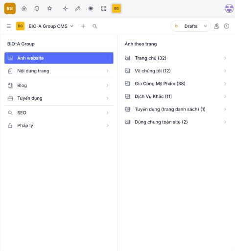
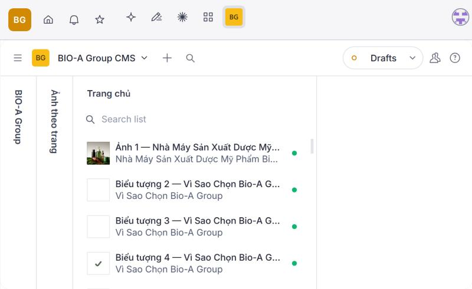
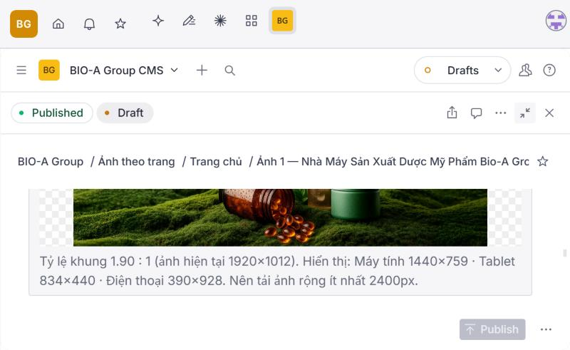
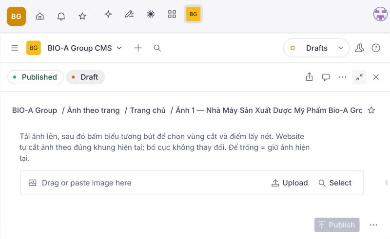
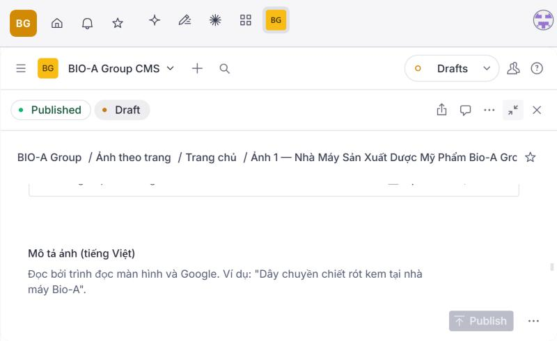
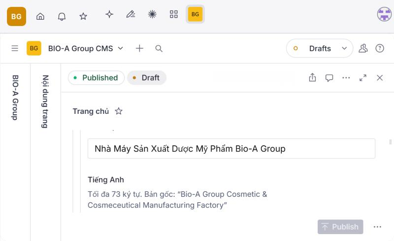
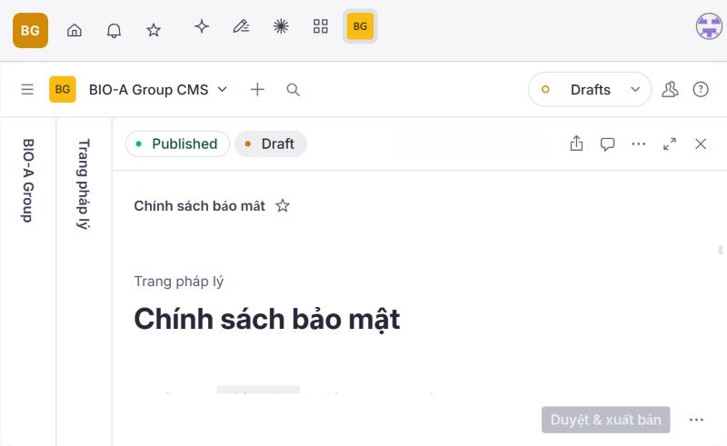

# Hướng dẫn dùng Sanity CMS cho website BIO-A Group

Hướng dẫn này dành cho người không cần biết lập trình. Mọi thao tác đều làm trên trình duyệt.

- **Địa chỉ quản trị:** https://bioagroup.sanity.studio/
- **Tài khoản:** tài khoản Sanity của BIO-A (đăng nhập bằng GitHub `bioagroupsale`).
- Ảnh minh họa nằm trong thư mục `docs/cms-guide/`.

## Bạn sửa được gì, không sửa được gì

| Sửa được trong CMS | Không sửa qua CMS (giữ cố định, đã OWNER PASS) |
|---|---|
| Thay ảnh ở 41 vị trí ảnh nội dung (Trang chủ, Về chúng tôi, Gia Công Mỹ Phẩm, Dịch Vụ Khác, trang Tuyển dụng) | Bố cục, màu, font, khoảng cách, hiệu ứng, slider; icon, logo, dấu chứng nhận, ảnh Header/Footer/cookie/chat (đã khóa) |
| Sửa 410 đoạn chữ (VI + EN) của Trang chủ, Về chúng tôi, Gia Công Mỹ Phẩm, Dịch Vụ Khác, Liên hệ, trang Tuyển dụng | Header, menu, Footer, nút CTA, form báo giá, khung chat, banner cookie, logo BIO-A |
| Viết và sửa bài Blog (VI/EN), ảnh đại diện, SEO bài viết | Thêm mục mới, bố cục mới trên trang (cần lập trình viên làm một lần rồi mới đưa vào CMS) |
| Quản lý vị trí tuyển dụng (Nháp / Mẫu / Đang tuyển / Ngừng tuyển) | Đường dẫn của trang và bài viết đã có |
| SEO 9 trang: tiêu đề, mô tả, ảnh chia sẻ | Mã HTML, CSS, script |
| Chính sách bảo mật và Chính sách cookie (có bước duyệt) | |

## Website cập nhật như thế nào

```
Bạn bấm "Publish" trong Studio
   → website Preview tự build lại (khoảng 2–4 phút)
   → bạn kiểm tra trên Preview
   → khi muốn đưa lên website chính: OWNER duyệt phát hành (bước riêng, xem mục 6)
```

- **Lưu nháp** (Studio tự lưu khi bạn gõ) **không bao giờ** lên website.
- **Website chính (Production)** không đọc Sanity trực tiếp: chỉ hiển thị **gói nội dung đã được OWNER duyệt phát hành** (xem `docs/CMS_RELEASE_PLAN.md`). Bấm Publish chỉ cập nhật Preview.
- Chỉ nội dung đã bấm **Publish** mới được đưa vào lần build kế tiếp.
- Nếu CMS lỗi hoặc dữ liệu sai quy định (ví dụ chữ dài quá khung), lần build đó **dừng lại**; website giữ nguyên bản cũ.

---

## 1. Đăng nhập Sanity

1. Mở https://bioagroup.sanity.studio/
2. Bấm **Continue with GitHub** và đăng nhập tài khoản GitHub của BIO-A.
3. Menu bên trái gồm: **Ảnh website · Nội dung trang · Blog · Tuyển dụng · SEO · Pháp lý**.



## 2. Tìm trang và vị trí

- **Ảnh:** bấm **Ảnh website**, chọn trang (ví dụ *Trang chủ (32)*). Mỗi dòng là một vị trí, đặt tên theo mẫu "Ảnh 3 — tên mục (tên file hiện tại)". Ảnh nhỏ bên trái là ảnh đang hiển thị trên website.
- **Chữ:** bấm **Nội dung trang**, chọn trang. Các đoạn được nhóm theo mục trên trang; bấm tên mục để mở.
- Danh sách đầy đủ vị trí kèm kích thước khung nằm ở `docs/CMS_CONTENT_MAP.md`.



## 3. Thay ảnh

1. Mở vị trí ảnh. Phần **Ảnh đang hiển thị trên website** cho biết ảnh hiện tại, tỷ lệ khung và kích thước hiển thị trên máy tính, tablet, điện thoại.
2. Ở **Ảnh mới (BIO-A)**, bấm **Upload** và chọn ảnh **JPEG, PNG hoặc WebP** (không nhận SVG). Nên dùng ảnh có chiều ngang lớn hơn hoặc bằng mức khuyến nghị.
3. Bấm biểu tượng **bút chì** trên ảnh để chọn:
   - **vùng cắt** (crop): phần ảnh được phép dùng;
   - **điểm lấy nét** (hotspot): phần quan trọng phải luôn nằm trong khung.
4. Nhập **Mô tả ảnh** tiếng Việt và tiếng Anh. Hai ô này bắt buộc khi đã chọn ảnh mới.
5. Bấm **Publish**.

Một vị trí có thể có nhiều khung: bản máy tính, bản điện thoại, hoặc bản `<picture>` riêng cho điện thoại. Studio ghi rõ từng bản. Website cắt **một bản cho từng khung** theo đúng tỷ lệ cũ, nên bố cục không đổi trên mọi thiết bị. Mỗi vị trí độc lập: thay ảnh này không ảnh hưởng vị trí khác, kể cả khi hai vị trí đang dùng chung một file gốc (ví dụ thẻ "Tuýp & chai chân không" và thẻ "Gói Sachet").





## 4. Chỉnh nội dung chữ

1. Mở **Nội dung trang** → trang → mục.
2. Mỗi đoạn có ô **Tiếng Việt** và **Tiếng Anh**, đã điền sẵn nội dung hiện tại.
3. Sửa trực tiếp trong ô. Dưới mỗi ô ghi giới hạn ký tự và nội dung gốc để bạn đối chiếu.
4. Bấm **Publish**.



Quy tắc:

- Không vượt quá số ký tự cho phép. Studio báo đỏ và không cho xuất bản nếu vượt.
- Không gõ mã HTML, dấu `<` hay `>`.
- Ô nhiều dòng: mỗi lần xuống dòng trong ô là một lần xuống dòng trên website.
- Để trống một ô thì website dùng lại nội dung gốc.
- Một số đoạn xuất hiện nhiều lần (bản máy tính và bản điện thoại): sửa một lần là đổi tất cả.
- Tiêu đề Blog và tiêu đề trang được website tự viết hoa chữ cái đầu mỗi từ (quy tắc đã duyệt), nên chữ viết tắt như "CMS" có thể hiển thị thành "Cms".

## 5. Xem trước

- Sau khi bấm **Publish**, đợi 2–4 phút rồi mở website **Preview**: https://cms-sanity-r25.bioagroup.pages.dev/
- Kiểm tra trang vừa sửa trên máy tính, tablet và điện thoại.
- Preview chỉ để kiểm tra, không được Google lập chỉ mục.
- Lưu ý: link Preview ai có cũng mở xem được, nên không chia sẻ công khai.

## 6. Xuất bản

**Xuất bản trong Studio:** bấm nút **Publish** (góc dưới bên phải). Nội dung lên website Preview ở lần build kế tiếp.

**Blog:**

1. Vào **Blog**, bấm **+**, điền tiêu đề VI/EN, đường dẫn (bấm **Generate**), ngày đăng, thời gian đọc, tóm tắt, mở bài và ít nhất 2 mục, rồi chọn ảnh đại diện.
2. Bài chỉ lên website khi bấm **Publish**; lúc chưa Publish là bản nháp.
3. Bài mới tự xếp vào danh sách Blog theo ngày đăng, mục lục tự tạo từ tiêu đề các mục.

**Tuyển dụng:**

- **Nháp:** không hiển thị.
- **Mẫu:** hiển thị như hiện nay, các phần chế độ, địa điểm và cách ứng tuyển ghi "đang cập nhật".
- **Đang tuyển:** công bố chính thức. Bắt buộc điền tab **Thông tin chính thức** (hình thức · địa điểm, quyền lợi, địa điểm & hình thức làm việc, cách ứng tuyển).
- **Ngừng tuyển:** ẩn khỏi danh sách; trang chi tiết ghi "Đã ngừng tuyển".

Chỉ người được OWNER cho phép mới chuyển một vị trí sang **Đang tuyển**.

**Pháp lý:** trang Chính sách bảo mật và Chính sách cookie không có nút Publish thường, chỉ có **Duyệt & xuất bản**.

1. Bấm **Duyệt & xuất bản**.
2. Xác nhận trong hộp thoại.



Studio lưu tên người duyệt, thời điểm duyệt và **mã nội dung**. Nếu nội dung bị sửa sau khi duyệt mà không bấm "Duyệt & xuất bản" lại, mã không còn khớp và website giữ văn bản cũ đã duyệt trong code.

**Website chính (bioagroup.vn):** hiện **chưa** đọc dữ liệu CMS và vẫn ở chế độ bảo trì. CMS chỉ được bật cho website chính sau khi OWNER duyệt kết quả trên Preview; đó là một bước phát hành riêng.

## 7. Hoàn tác

- **Hoàn tác một tài liệu:** mở tài liệu, bấm biểu tượng **đồng hồ (History)** ở góc trên bên phải, chọn phiên bản cũ, bấm **Restore**, rồi bấm **Publish**. Website trở lại nội dung đó ở lần build kế tiếp.
- **Bỏ ảnh mới, dùng lại ảnh cũ:** mở vị trí ảnh, bấm **…** trên ảnh mới, chọn **Remove**, rồi bấm **Publish**.
- **Gỡ bài Blog mới khỏi website:** mở bài, bấm mũi tên cạnh **Publish**, chọn **Unpublish**. Với 38 bài cũ, Unpublish sẽ đưa bài về nội dung gốc trong code; đường dẫn bài vẫn còn.
- **Sửa nháp nhưng muốn bỏ:** bấm **…**, chọn **Discard changes**.

Bài QA của đợt tích hợp (CMS-R25) đã thử đủ vòng: sửa → Publish → build → Restore → website giống hệt bản đã duyệt.

## Khi gặp lỗi

| Hiện tượng | Nguyên nhân thường gặp | Cách làm |
|---|---|---|
| Nút Publish mờ, có chấm đỏ | Còn ô sai quy định (quá dài, thiếu mô tả ảnh, thiếu thông tin chính thức) | Bấm chấm đỏ để xem ô cần sửa |
| Preview không đổi sau 10 phút | Lần build bị dừng do dữ liệu không hợp lệ hoặc CMS tạm lỗi | Báo người quản trị kỹ thuật; website vẫn giữ bản cũ |
| Ảnh bị cắt mất phần quan trọng | Điểm lấy nét chưa đúng | Bấm bút chì, kéo điểm lấy nét vào phần quan trọng, rồi Publish lại |
